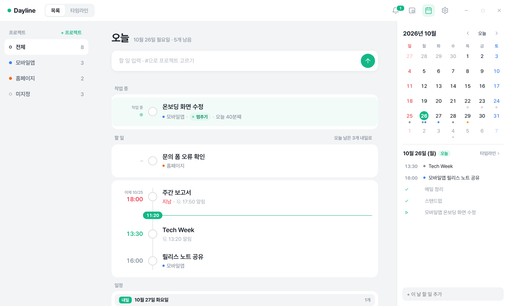
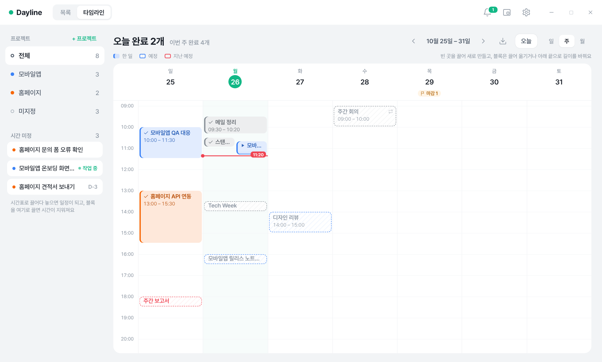
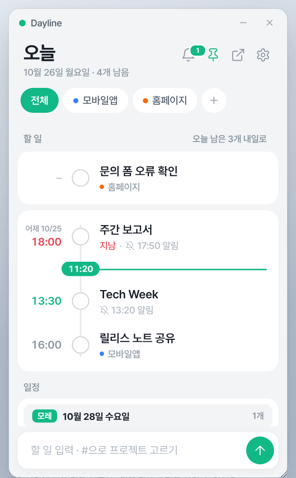
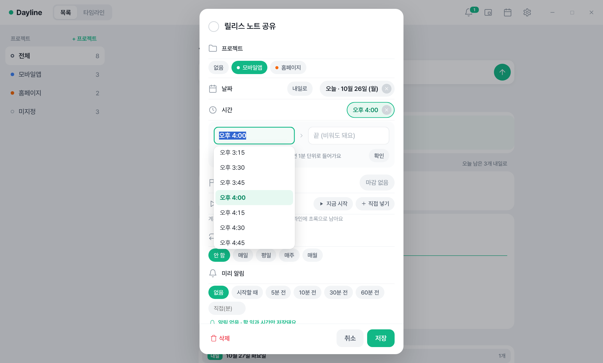

# Dayline

**할 일과 타임라인을 한 화면에.** 문장으로 치면 시간·마감·프로젝트를 알아서 읽고, 체크하면 오늘 한 일로 남는 Windows 업무용 할 일 앱이에요.



## 이런 걸 할 수 있어요

- **문장으로 입력**: `2시 디자인 리뷰`, `내일 10:00 회의`, `3시-4시 미팅 #홈페이지`, `기획서 검토 목요일까지`처럼 치면 시간·날짜·마감·프로젝트가 잡혀요. 치는 동안 어떻게 읽었는지 미리 보여줘요.
- **타임라인**: 일·주·월로 봐요. 빈 곳을 끌어 일정을 만들고, 블록을 옮기거나 길이를 바꿔요. 계획한 일정은 점선, 완료한 일과 작업한 시간은 색 블록으로 남아요.
- **계획과 실제를 따로**: ▶ 시작을 누르면 실제 작업 시간이 기록돼요. 계획 시간이 지났는데 시작하지 않았으면 "시작 전"으로 알려주고, ⏰ 미루기로 30분·1시간·2시간 뒤나 내일로 옮길 수 있어요.
- **메모와 사진**: 할 일마다 메모를 적고, 캡처를 붙여넣거나 사진을 끌어다 놓아 함께 둬요.
- **마감과 반복**: 마감은 D-n으로 보이고, `매주 수요일 9시 주간 회의`처럼 반복 일정도 만들어요.
- **옆 달력**: 날짜마다 할 일·마감이 점으로 보이고, 할 일을 날짜 위로 끌어 옮겨요.
- **작은 메모창**: 바탕화면 위에 항상 떠 있는 작은 창으로 바꿔 쓸 수 있어요.
- **Windows 알림**: 미리 알림이 Windows 알림으로 오고, 알림에서 바로 완료할 수 있어요.
- **가져오기·내보내기**: 메모나 스티커 메모의 줄을 할 일로 한 번에 가져오고, 한 일을 기간별로 Markdown·CSV로 내보내요.
- **자동 백업**: 하루 한 번 `문서\Dayline 백업`에 저장하고 최근 30일 치를 남겨요. 백업에서 통째로 되돌리거나 합칠 수 있어요.
- **단축키**: 어디서든 `Ctrl + Shift + Space`로 창을 열고 바로 입력해요.

| 주간 타임라인 | 작은 메모창 |
| --- | --- |
|  |  |



## 설치

1. [Releases](https://github.com/kimohzl/dayline/releases)에서 최신 `Dayline Setup x.y.z.exe`를 내려받아 실행하세요.
2. 서명하지 않은 앱이라 "Windows의 PC 보호" 창이 뜰 수 있어요. **추가 정보 → 실행**을 누르면 설치돼요.
3. 설치가 끝나면 바로 실행되고, 바탕화면과 시작 메뉴에 Dayline이 생겨요. 처음 실행할 때 짧은 안내와 "컴퓨터를 켤 때 Dayline도 켤까요?"를 물어봐요.

Windows 10·11에서 동작해요. 새 버전을 설치해도 데이터는 그대로예요.

## 사용법

처음 실행하면 나오는 안내와 **설정 → 도움 → 사용법**에 기능별 설명이 있어요. 모든 동작과 입력 규칙은 [docs/GUIDE.md](docs/GUIDE.md)에 정리해 뒀어요.

## 데이터와 개인정보

- 할 일과 설정은 **내 PC에만** 저장돼요. 계정이나 서버가 없어요.
- **설정 → 의견 보내기**를 직접 눌러 보낼 때만 적은 내용과 첨부한 파일, 앱 버전, Windows 버전이 개발자에게 메일로 가요. 할 일 내용은 같이 가지 않아요.

## 직접 실행하고 빌드하기

[Node.js](https://nodejs.org)가 필요해요.

```bash
npm install
npm start          # 개발용으로 바로 실행
npm run build:win  # release 폴더에 Windows 설치 파일 생성
```

설치 없이 `index.html`을 Chrome이나 Edge로 열면 브라우저 데모로 볼 수 있어요. `index.html?reset`을 붙이면 예시 데이터로 시작해요(트레이·항상 위·Windows 알림 같은 기능은 앱에서만 동작해요).

| 폴더·파일 | 내용 |
| --- | --- |
| `index.html`, `styles.css` | 화면 |
| `js/parser.js` | 문장 속 시간·날짜·마감 인식 |
| `js/app.js` | 할 일, 타임라인, 알림, 드래그 등 화면 동작 |
| `electron/` | 창, 트레이, Windows 알림, 자동 실행, 백업, 스티커 메모 읽기 |
| `tools/feedback-apps-script.gs` | 의견 보내기를 받는 Google Apps Script |

포크해서 쓸 때는 `js/app.js`의 `FEEDBACK_URL`을 직접 배포한 Apps Script 주소로 바꾸거나 비워 두세요. 비워 두면 의견 보내기가 메일 앱을 열어요.

## 라이선스

[MIT](LICENSE) © 2026 Kim Aeri

글꼴은 [Pretendard](https://github.com/orioncactus/pretendard)(SIL Open Font License)를 함께 담고 있어요.
